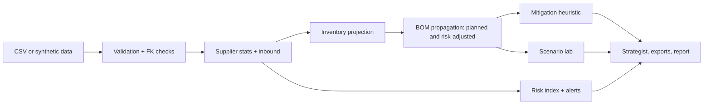

# ORBIT AI — Supply Chain Risk & Resilience Intelligence
See the disruption before it hits production.

Connects supplier signals, inventory, shipments and bills of materials to show which production orders and customer deliveries a disruption threatens, then proposes and simulates mitigations. Bundled data is **fictional synthetic data** with planted disruptions; nothing is live.

## Architecture


## Run
```
pip install -r requirements.txt
python app.py
```
In Google Colab paste `app.py` into one cell. The `src/` modules in the brief are consolidated into `app.py`.

## Tests, docs, privacy
`pip install pytest && pytest tests` runs the built-in self-tests. See `docs/`. Optional LLM: set `ANTHROPIC_API_KEY` (see `.env.example`); off by default. Not included: supervised model, OR-Tools, PDF. Never commit real company data or keys. Add screenshots to `screenshots/`.
